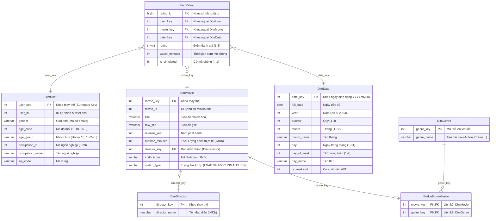

# SƠ ĐỒ THIẾT KẾ KHO DỮ LIỆU (STAR SCHEMA ERD)

## 1. Mô hình Star Schema tổng thể

Kho dữ liệu được thiết kế theo **Lược đồ hình sao (Star Schema)** mở rộng với 2 bảng cầu nối (*Bridge Tables*) để chuẩn hóa mối quan hệ nhiều-nhiều (N-N), tuân thủ chặt chẽ kiến trúc kho dữ liệu môn học:

---

## 2. Đặc tả các thành phần kho dữ liệu

### 2.1. Mức độ chi tiết (Grain)
- **FactRating Grain:** Mỗi bản ghi trong `FactRating` đại diện cho **1 sự kiện đánh giá phim của 1 người dùng cụ thể đối với 1 bộ phim vào 1 ngày xác định**.
- Bảng Fact chứa:
  - **3 Khóa ngoại:** `user_key`, `movie_key`, `date_key`.
  - **2 Độ đo (Measures):** `rating` (độ đo đại số: AVG, MIN, MAX), `watch_minutes` (độ đo phân phối: SUM, AVG).
  - **1 Cờ metadata:** `is_simulated = 1` đánh dấu dữ liệu mô phỏng thời gian xem.

### 2.2. Xử lý quan hệ Nhiều - Nhiều (Bridge Tables)
- Một bộ phim thường thuộc về nhiều thể loại (ví dụ: *Action|Adventure|Thriller*). Để tránh dư thừa dữ liệu và duy trì tính toàn vẹn bậc 3NF cho chiều Movie, bảng cầu nối `BridgeMovieGenre` được thiết kế liên kết `DimMovie` và `DimGenre`.
- Một bộ phim có thể có nhiều đạo diễn; theo quyết định thiết kế tối ưu hóa OLAP, ta chọn **Đạo diễn chính (Primary Director)** lưu tại `DimMovie(director_key)` tham chiếu `DimDirector`, các phim không tìm thấy đạo diễn từ IMDb gán vào bản ghi `Unknown`.

### 2.3. Chiến lược phân tầng Schema
- **Schema Staging (`stg`):** Lưu trữ tạm thời dữ liệu từ các tệp thô, không ràng buộc khóa ngoại để nạp cực nhanh.
- **Schema Kho Dữ Liệu (`dw`):** Triển khai lược đồ Star Schema với khóa thay thế (*Surrogate Keys* `IDENTITY`), ràng buộc toàn vẹn khóa chính - khóa ngoại (*Referential Integrity*), và các chỉ mục phi cụm (*Non-clustered Indexes*) phục vụ truy vấn OLAP thời gian thực.
